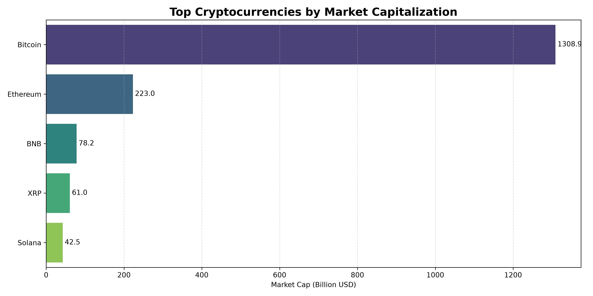
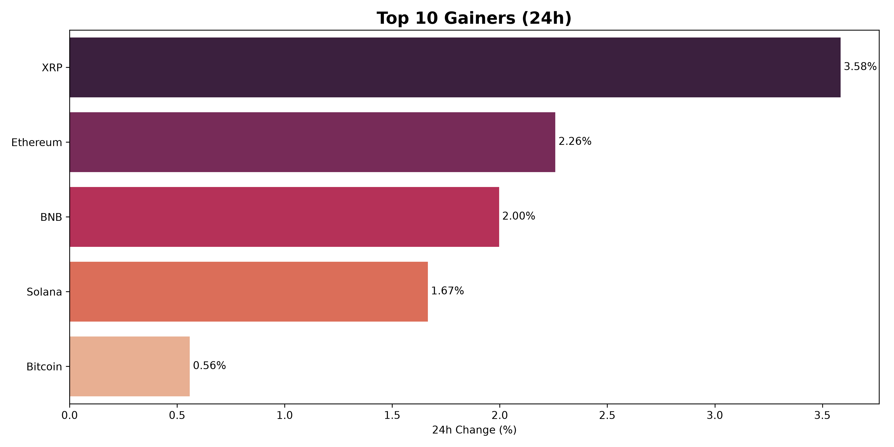

# 🚀 Crypto Market Data Pipeline

A Python data pipeline that extracts real-time cryptocurrency market data from the CoinGecko API, stores it in CSV format, and generates analytical reports with visualizations.

---

## 📌 Project Overview

This project demonstrates an end-to-end data workflow:

- Data extraction from the CoinGecko API
- Data storage into CSV files
- Market analysis using Pandas
- Visualization with Matplotlib and Seaborn
- Generation of professional reports

The goal is to provide insights into cryptocurrency market trends, market capitalization rankings, and daily gainers.

---

## 📊 Features

✅ Connects to the CoinGecko API

✅ Retrieves real-time cryptocurrency data

✅ Stores data in CSV format

✅ Analyzes cryptocurrency market capitalization

✅ Identifies the top daily gainers

✅ Generates professional visual reports

✅ Uses Pandas for data manipulation

✅ Uses Matplotlib and Seaborn for visualization

---

## 🛠 Technologies Used

- Python
- Pandas
- Requests
- Matplotlib
- Seaborn
- CoinGecko API

---

## 📁 Project Structure

```text
crypto-market-data-pipeline
│
├── data
│   └── crypto_prices.csv
│
├── reports
│   ├── top_marketcap.png
│   └── top_gainers.png
│
├── src
│   ├── extract.py
│   ├── analytics.py
│   └── main.py
│
├── requirements.txt
└── README.md
```

---

## ⚙️ Installation

Clone the repository:

```bash
git clone https://github.com/Alpha38diallo/crypto-market-data-pipeline.git

cd crypto-market-data-pipeline
```

Create a virtual environment:

```bash
python -m venv venv
```

Activate the environment:

### macOS / Linux

```bash
source venv/bin/activate
```

### Windows

```bash
venv\Scripts\activate
```

Install dependencies:

```bash
pip install -r requirements.txt
```

---

## ▶️ Usage

### Extract cryptocurrency data

```bash
python src/main.py
```

Output:

```text
data/crypto_prices.csv
```

### Generate analytics reports

```bash
python src/analytics.py
```

Outputs:

```text
reports/top_marketcap.png
reports/top_gainers.png
```

---

## 📈 Sample Visualizations

### Top Cryptocurrencies by Market Capitalization



This report highlights the largest cryptocurrencies by market capitalization. Bitcoin remains the dominant asset, followed by Ethereum and Binance Coin.

---

### Top 10 Gainers (24h)



This report shows the cryptocurrencies that achieved the strongest price performance over the previous 24 hours.

---

## 🔍 Key Insights

- Bitcoin dominates the cryptocurrency market with a capitalization exceeding 1 trillion USD.
- Ethereum remains the second-largest cryptocurrency by market value.
- Market capitalization is heavily concentrated among a small number of assets.
- Daily performance leaders can be quickly identified through visual analysis.

---

## 📋 Requirements

```txt
pandas
requests
matplotlib
seaborn
```

---

## 🎯 Future Improvements

- PostgreSQL integration
- Historical data storage
- Automated ETL workflows
- Airflow scheduling
- Interactive dashboards with Streamlit
- Automated daily reporting
- Docker containerization

---

## 👨‍💻 Author

**Alpha Diallo**

Aspiring Data Engineer & Data Analyst

GitHub: https://github.com/Alpha38diallo

---

## 📜 License

This project is released under the MIT License.
